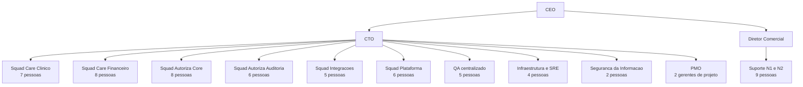

# Estrutura das Equipes

## Organograma de tecnologia

## Distribuição das 86 pessoas de tecnologia

| Grupo | Pessoas | Responsabilidade atual |
| --- | --- | --- |
| Squads de produto e integração | 40 | Desenvolvimento do Care, do Autoriza e das customizações |
| QA centralizado | 5 | Teste manual de todos os squads, concentrado no fim da iteração |
| Infraestrutura e SRE | 4 | Ambientes, deploy manual e monitoramento |
| Segurança da Informação | 2 | Política, gestão de acessos e acompanhamento do pentest anual |
| PMO | 2 | Cronograma e relacionamento nos contratos de implantação |
| Suporte N1 e N2 | 9 | Atendimento de chamados e triagem para os squads |
| Product Owners | 4 | Priorização do Care e do Autoriza |
| Arquitetura | 2 | Decisões técnicas sem registro formal |
| Demais funções | 18 | Dados, implantação em cliente e treinamento |

## Observações do diagnóstico

Os seis squads não trabalham do mesmo modo. Quatro seguem um Scrum informal com sprints de duas semanas, enquanto o Squad Integrações e o Squad Plataforma operam por demanda, sem cadência. Essa divergência não é uma escolha documentada, e sim o resultado de equipes formadas em momentos diferentes.

O QA centralizado responde a todos os squads ao mesmo tempo, o que transforma a última semana de cada iteração em gargalo previsível.

O Suporte responde ao Diretor Comercial, e não ao CTO. Isso faz com que a priorização de chamados chegue aos squads por fora da estrutura de tecnologia, sem negociação de capacidade.

A arquitetura não tem papel formal. Dois desenvolvedores seniores atuam de fato como arquitetos, sem que as decisões sejam registradas em lugar algum, o que contribui para a concentração de conhecimento descrita no problema P09.
