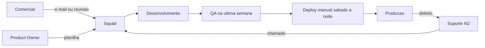

# Práticas Atuais

Retrato as-is do desenvolvimento na Vértice Sistemas, levantado nas entrevistas, na extração de dados e na observação de duas sprints.

## Fluxo atual da demanda

A demanda chega por três portas que não se comunicam. Não existe fila única, triagem comum nem classificação, o que impede qualquer previsão de capacidade.

## Prática por disciplina

| Disciplina | Como é feito hoje | Grau de formalização |
| --- | --- | --- |
| Entrada e priorização | Comercial, Suporte e Product Owner acionam o squad diretamente | Inexistente |
| Requisitos | Registro em planilha mantida por cada squad, formato livre | Baixo |
| Estimativa | Estimativa verbal do squad lead, sem técnica definida | Inexistente |
| Arquitetura | Decisões tomadas por dois desenvolvedores seniores, sem registro | Inexistente |
| Codificação | Git no Azure DevOps, branch por demanda, revisão de código opcional | Parcial |
| Teste | Manual, executado pelo QA centralizado na semana anterior à entrega | Baixo |
| Automação de teste | Cobertura pontual no Care, ausente no Autoriza | Baixo |
| Implantação | Manual, em janela noturna de sábado, roteiro em documento desatualizado | Baixo |
| Segurança | Pentest externo uma vez por ano, aplicado ao Autoriza antes do go-live | Parcial |
| Privacidade | Avaliação feita apenas quando um cliente solicita | Inexistente |
| Gestão de mudanças | Alterações de escopo aceitas verbalmente nos projetos contratados | Inexistente |
| Documentação | Arquivos Word em pasta compartilhada, sem versionamento nem revisão | Baixo |
| Medição | Nenhum indicador de processo é coletado | Inexistente |

## Cadência observada

| Squad | Cadência declarada | Cadência observada |
| --- | --- | --- |
| Care Clínico | Sprint de duas semanas | Planning e review realizadas, retrospectiva omitida em 4 das 6 últimas sprints |
| Care Financeiro | Sprint de duas semanas | Sprint interrompida por chamado urgente em 5 das 6 últimas |
| Autoriza Core | Sprint de duas semanas | Cerimônias realizadas, backlog sem critério de aceite |
| Autoriza Auditoria | Sprint de duas semanas | Escopo redefinido no meio da sprint com frequência |
| Integrações | Por demanda | Trabalho puxado do e-mail, sem quadro |
| Plataforma | Por demanda | Trabalho puxado do chamado, sem quadro |

## Leitura do retrato

A Vértice tem prática ágil declarada e execução informal. As cerimônias existem no calendário, mas o que falta são os elementos que dão sustentação a elas, como critério de aceite, definição de pronto, fila única e proteção da capacidade. O resultado aparece nos problemas registrados em [Registro de Problemas e Oportunidades](./Registro-de-Problemas-e-Oportunidades.md).
