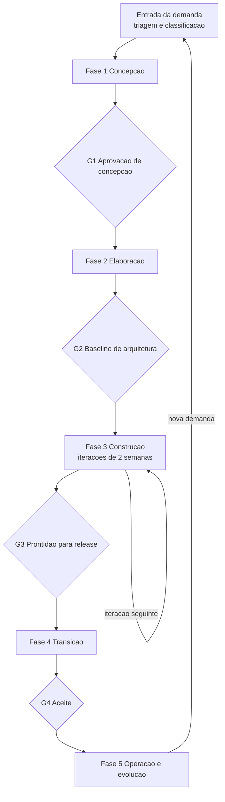

# Ciclo de Vida e Justificativa

## Nome e definição

O processo proposto recebe o nome de **Processo Vértice de Desenvolvimento**, abreviado como PVD. O ciclo de vida é **iterativo e incremental com fases e marcos de aprovação**. As fases e os gates vêm do Processo Unificado e a execução dentro da construção é ágil, com iterações de duas semanas.

## Visão geral

## Por que este ciclo

A Vértice precisa de duas coisas que costumam ser tratadas como incompatíveis. Os contratos de implantação exigem escopo e prazo acordados antes do compromisso comercial, o que pede marcos formais. O SaaS exige release quinzenal, o que pede cadência curta. Um ciclo em cascata atenderia o primeiro e inviabilizaria o segundo, e um ciclo puramente iterativo faria o contrário.

A solução adotada separa as duas necessidades em planos diferentes. As fases e os gates dão o controle macro, exigido pelos contratos e pela regulação. A construção interna é iterativa, o que preserva a cadência do produto. A categoria da demanda decide quantas fases ela percorre, e é esse mecanismo que permite ao mesmo processo servir a um contrato de quatro meses e a uma correção de quatro horas.

## Decisões estruturais e suas razões

| Decisão | Problema atendido | Justificativa no contexto da Vértice |
| --- | --- | --- |
| Adotar fases com gates de aprovação | P03, P11 | 14 de 20 projetos atrasaram porque o prazo foi acordado antes do escopo ser entendido. O gate G1 move o compromisso para depois da concepção |
| Manter a construção iterativa em duas semanas | P01 | Quatro squads já operam assim, o que reduz a resistência e o custo de transição |
| Criar ponto de entrada diferente por categoria | P01, P08 | Submeter 400 chamados mensais às fases de concepção paralisaria o atendimento |
| Tornar o gate G3 obrigatório antes de qualquer release | P05 | Três rollbacks em 2025 com janela média de seis horas, sem critério objetivo de prontidão |
| Distribuir atividades de segurança pelas fases | P06 | Achados do pentest anual levam em média 60 dias para serem corrigidos, custo que cai quando a verificação acontece durante o ciclo |
| Reservar capacidade fixa para sustentação | P08 | A demanda não planejada já consome 35% da capacidade, e hoje isso acontece sem acordo |
| Instituir disciplinas transversais | P02, P07, P09, P10 | Requisitos, qualidade, segurança, configuração, riscos e medição precisam existir em todas as fases, não como etapa isolada |

## Disciplinas transversais

Seis disciplinas atravessam todas as fases e não constituem etapa separada.

| Disciplina | O que garante | Artefato principal |
| --- | --- | --- |
| Gestão de requisitos e rastreabilidade | Que toda entrega tenha origem identificável | Matriz de rastreabilidade |
| Garantia de qualidade | Que a verificação aconteça durante a construção | Plano de testes e evidência de teste automatizado |
| Segurança e privacidade | Que o risco seja avaliado antes do código | Avaliação de risco e relatório de ameaças |
| Gestão de configuração e mudanças | Que versões e alterações sejam controladas | Procedimento de controle de mudanças |
| Gestão de riscos | Que a ameaça ao projeto seja registrada e respondida | Registro de riscos |
| Medição e melhoria | Que o processo seja avaliado com dados | Painel de indicadores |

## O que fica fora deste ciclo

A categoria E, de inovação, percorre um ciclo próprio e curto, com três etapas apenas, que são definição da hipótese, experimento e decisão de seguir ou abandonar. A razão é que submeter uma prova de conceito descartável a gates formais eliminaria a função do laboratório. O detalhe está em [Categorias de Projeto](./Categorias-de-Projeto.md).
