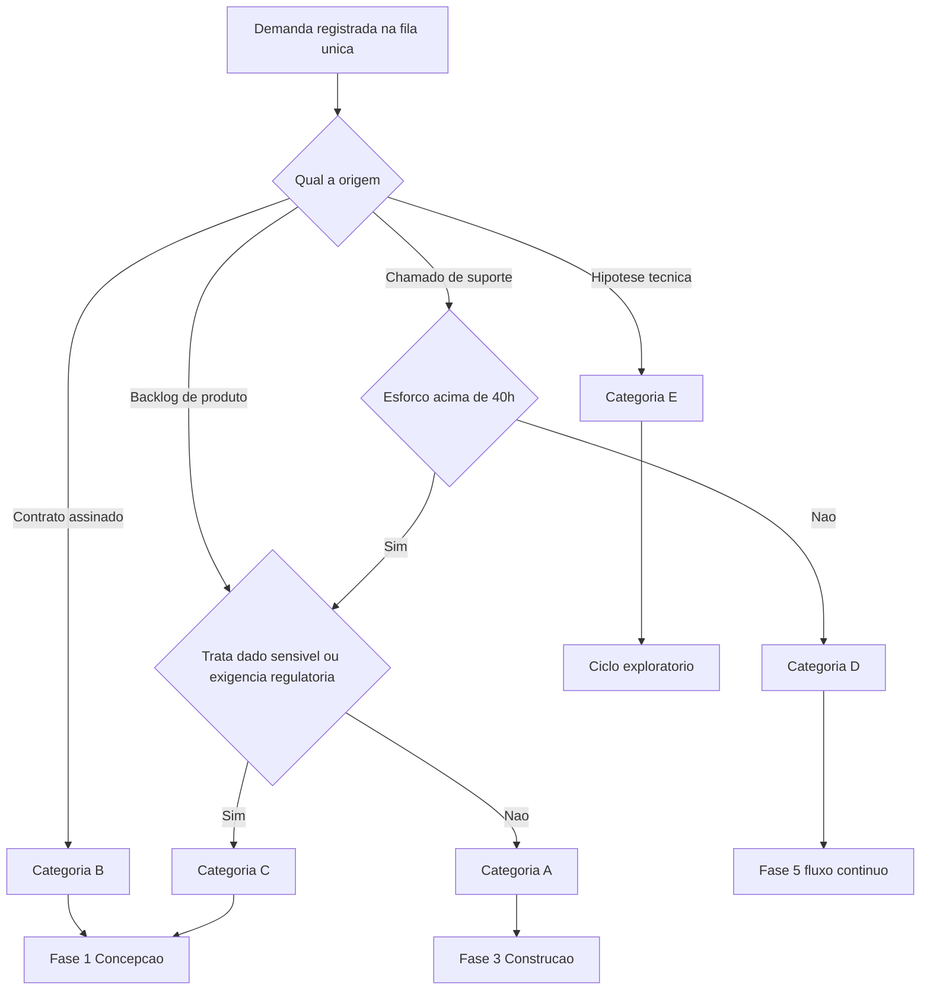
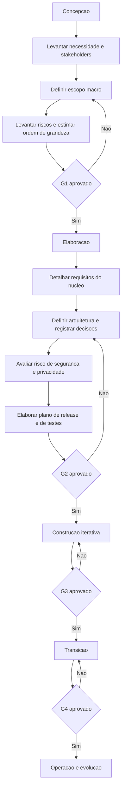
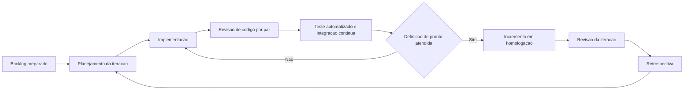
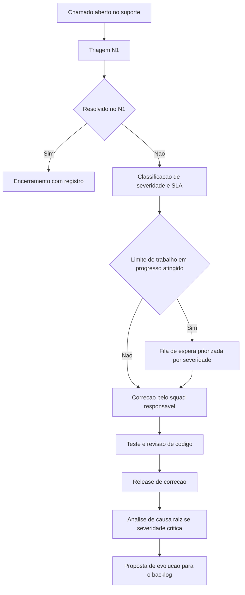
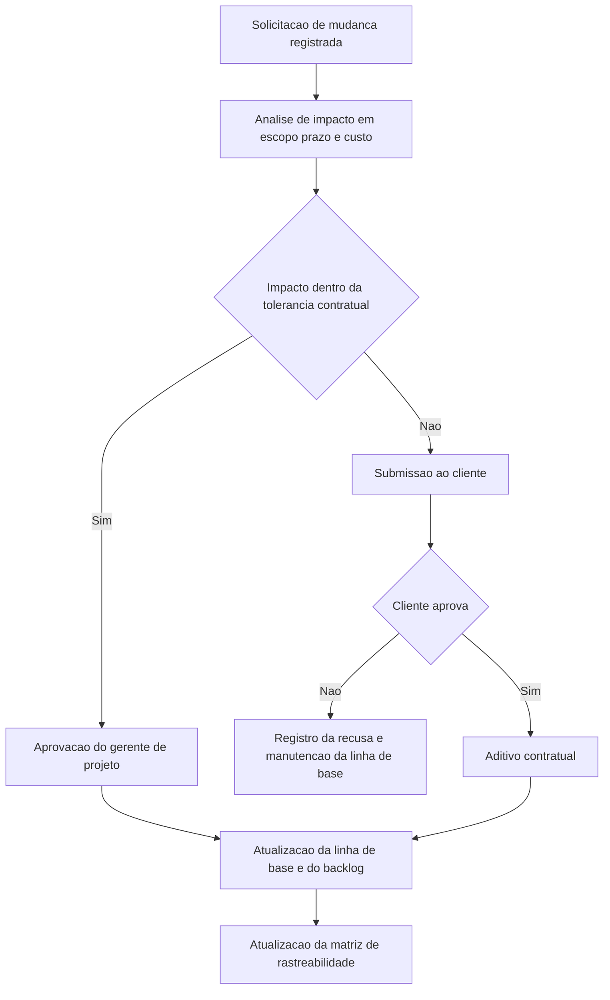
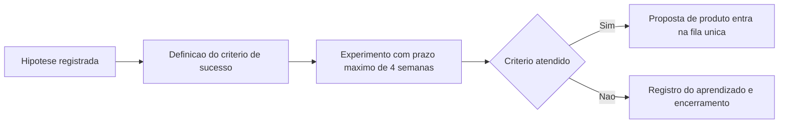

# Modelagem das Atividades

Os fluxos abaixo estão em notação de diagrama de atividades simplificado, renderizados em Mermaid pela Wiki. Confirmem com o professor se a disciplina exige BPMN formal, caso em que estes diagramas servem de rascunho para a modelagem em ferramenta própria.

## Fluxo de entrada e classificação da demanda

## Fluxo das fases planejadas, categorias B e C

## Fluxo da iteração de construção

## Fluxo da sustentação, categoria D

## Fluxo de controle de mudanças, categorias B e C

Este fluxo é a resposta a P11. Hoje a alteração de escopo é aceita verbalmente, sem análise de impacto e sem registro oponível ao cliente.

## Fluxo do ciclo exploratório, categoria E

