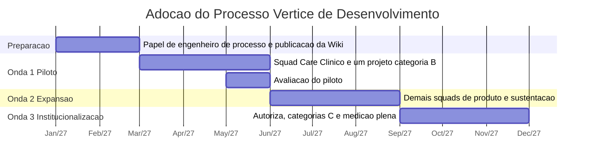

# Plano de Implantação

A adoção acontece em três ondas ao longo de nove meses. Implantar o processo em seis squads ao mesmo tempo repetiria o erro que o processo tenta corrigir, porque não haveria capacidade de ajuste.

## Linha do tempo

## Onda 0, preparação

| Ação | Responsável | Resultado esperado |
| --- | --- | --- |
| Designar o engenheiro de processo | CTO | Papel preenchido em dedicação integral |
| Publicar o processo na Wiki e os templates | Engenheiro de processo | Documentação acessível a toda a tecnologia |
| Configurar áreas, iterações, campos e tags no Azure DevOps | Engenheiro de processo e SRE | Campo de categoria obrigatório em todo work item |
| Treinar squad leads, Product Owners e PMO | Engenheiro de processo | Oito horas por grupo, com exercício sobre casos reais |
| Coletar a linha de base dos indicadores | Engenheiro de processo | Valores iniciais registrados para comparação |

Duração de dois meses. O piloto não começa sem a linha de base coletada, porque sem ela não há como demonstrar efeito.

## Onda 1, piloto

Escopo restrito ao Squad Care Clínico, na categoria A, e a um projeto de implantação da categoria B escolhido entre os contratos do trimestre.

| Critério de avanço para a onda 2 | Valor exigido |
| --- | --- |
| Gates aplicados sem exceção no projeto piloto | 100% |
| Itens do squad piloto com critério de aceite escrito | Acima de 90% |
| Desvios registrados e instruídos | 100% dos desvios ocorridos |
| Percepção da equipe piloto sobre carga adicional | Aceitável ou melhor em pesquisa interna |
| Lead time do squad piloto | Sem piora em relação à linha de base |

A última linha é deliberada. O piloto precisa demonstrar que o processo não torna a entrega mais lenta, porque essa é a objeção que inviabilizaria a expansão.

## Onda 2, expansão

Escopo ampliado para os demais squads de produto e para o fluxo de sustentação em todas as equipes.

| Ação | Resultado esperado |
| --- | --- |
| Migrar a entrada de demanda para fila única | Comercial, Suporte e Product Owners usando o mesmo ponto de registro |
| Implantar o limite de trabalho em progresso e a reserva de capacidade | Interrupções não planejadas dentro dos 20% acordados |
| Realocar o QA para dentro dos squads | Teste distribuído ao longo da iteração |
| Ajustar a matriz de customização conforme os desvios do piloto | Matriz revisada com base em evidência |

## Onda 3, institucionalização

Escopo final, com a linha Autoriza, as categorias C e a medição plena.

| Ação | Resultado esperado |
| --- | --- |
| Aplicar o processo às categorias C com ASVS nível 2 | Modelagem de ameaças em todos os módulos regulatórios |
| Implantar security champion em todos os squads | Verificação de segurança durante a construção |
| Publicar o painel de indicadores | Revisão trimestral em funcionamento |
| Realizar a primeira revisão trimestral do processo | Primeira rodada de ajustes baseada em dados |

## Melhoria contínua após a implantação

| Elemento | Definição |
| --- | --- |
| Responsável | Engenheiro de processo |
| Cadência | Revisão trimestral com CTO, squad leads e PMO |
| Entrada da revisão | Indicadores do trimestre, desvios registrados, ações de retrospectiva não concluídas |
| Gatilho extraordinário | Incidente de severidade crítica, achado de auditoria ou mudança regulatória |
| Saída | Versão nova do processo publicada na Wiki, com registro do que mudou e por quê |

Um elemento dispensado por desvio três vezes seguidas na mesma categoria entra automaticamente na pauta da revisão.
